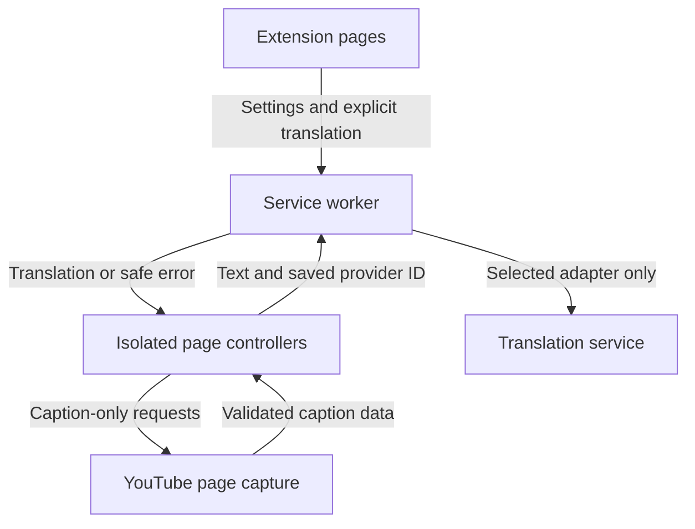

# Architecture

Kuai translate is a Manifest V3 extension written as native JavaScript modules. Browser code is shipped directly from `src/`; the build copies it without a transpiler or minifier. The Node scripts use only built-in modules.

## Source map

| Directory | Responsibility |
| --- | --- |
| `src/shared/` | Settings/presentation/interaction normalization, safe rule matching, migration, public views, CSS application and the message client |
| `src/providers/` | Translation adapters, response validation, deadlines and bounded HTTP responses |
| `src/background/` | Private settings, conflict-aware saves, provider requests, context menus and document ownership |
| `src/content/` | Page policy and triggers, reversible bilingual output, selection, guarded input edits and configurable hover |
| `src/youtube/` | Caption discovery, sessions, overlay/sidebar, public preferences, cue navigation and playback ownership |
| `src/ui/` | Popup, independent interaction sections, settings drafts, presentation previews and the local text/file tool |
| `public/` | Manifest, HTML, CSS, localized description and original icon assets |
| `tests/` | Node tests, controlled DOM fixtures and request fixtures |
| `scripts/` | Build, syntax/resource checks, icon generation and deterministic ZIP packaging |

## Browser execution contexts

The service worker is the only context that calls translation services. It reads the private provider records from `chrome.storage.local`, whose access level is restricted to trusted extension contexts. The popup, options page and text tool can read and edit complete settings. Content scripts receive a public view without API keys, endpoint addresses or regions.

YouTube's page-context capture script has a narrower role: observe caption metadata and timed-text responses, or retrieve a validated YouTube caption URL. It has no provider credentials or extension settings. Its messages are treated as untrusted input by the isolated content controller.



There is no Kuai server, automatic provider failover, remote executable code, extension account or analytics endpoint.

## Settings and concurrent editors

The canonical storage key remains `kuai.settings.v1` in version 1.2.1. `normalizeSettings()` accepts supported fields only, preserves named custom instances and reconciles disabled/deleted provider selections. Existing 1.0 / 1.1 / 1.2.0 settings receive defaults for missing presentation and interaction fields. `hoverOptions.displayMode` accepts `inline` or `popup`; missing or invalid values become `inline` without changing the separate enabled switch or saved gestures. Incomplete custom configurations may be saved while being edited; adapters validate the required fields when a request is made.

The UI saves `{settings, baseSettings}`. The worker serializes writes and performs a three-way merge between the editor's baseline, its draft and the current stored settings. Unchanged fields retain the latest value; `pageStyle`, `subtitleStyle`, `pageOptions`, `selectionOptions`, `inputOptions` and `hoverOptions` merge by their individual fields. Conflicting edits to the same field, deletion of an externally modified provider, and an endpoint/credential cross-edit return `SETTINGS_CONFLICT` without overwriting storage. The UI retains its draft until the user chooses to reload. Invalid shortcut/list drafts remain visible and are not silently saved by another control.

`providerRevision` is assigned by the worker when provider settings change. It lets content controllers invalidate cached translations after a private configuration change without receiving the credentials themselves. A blank custom-model temperature is `null` and is omitted from API requests.

The revision currently covers the whole provider list. Editing an unrelated provider may therefore cancel an in-flight selection/input popup using another independent provider; retry uses current settings. Per-provider revisions are deferred. Effective language identity is separate, so changing the webpage language does not invalidate a feature with its own fixed languages.

Default exports omit API keys and remove sensitive endpoint query values/fragments. When importing a secret-free backup, an existing key is retained only for the same provider identity, type and redacted endpoint. Changing the destination cannot silently carry an old key to it. Legacy import accepts recognized direct/free configurations and presentation data, not the previous product's account or membership state. The selected legacy theme's ID/custom values, historical `boderColor` field, subtitle font-size categories and opacity units are mapped into the new schema; imported values are validated and never executed as CSS or JavaScript. Custom settings for unselected legacy themes are not retained as additional style profiles.

Interaction migration maps recognized explicit legacy settings, including single-service choices, triggers, language/site rules and shortcuts. Legacy URL disable flags use `0` for disabled; safe URL wrappers are accepted as data. Missing values keep Kuai defaults. Multi-model lists/scoring, mobile gestures and context-summary settings are not mapped to supported behavior; `autoApplyBestTranslation` is not treated as the new single-service `autoApply` flag.

`pageDisplayMode` controls bilingual versus translation-only output. `pageStyle` holds 16 preset IDs and bounded typography/color settings. `subtitleTargetLanguage` is independent from the webpage target unless set to `follow_page`; `subtitleStyle` holds display mode/order, a study mask, separate source/target typography and box positioning. `showOriginal` is a compatibility alias derived from the subtitle display mode, not a second source of truth.

## Message contract

Every response uses one of these envelopes:

```js
{ ok: true, value }
{ ok: false, error: { code, message } }
```

| Message | Payload / result |
| --- | --- |
| `KUAI_GET_SETTINGS` | `{includeSecrets?}` → full settings for extension pages or a public settings view |
| `KUAI_SAVE_SETTINGS` | `{settings, baseSettings}` → merged full settings; extension pages only |
| `KUAI_TRANSLATE` | `{requestId, texts, sourceLanguage?, targetLanguage?, providerId?}` → `{translations, providerId}` |
| `KUAI_CANCEL` | `{requestId}` → cancellation within the sender's document scope |
| `KUAI_TEST_PROVIDER` | `{requestId?, provider, text?}` → a connection-test translation; extension pages only |
| `KUAI_UPDATE_PREFERENCES` | `{patch}` → public settings; only allowlisted subtitle preferences, with no provider credentials or page settings |
| `KUAI_UPDATE_PAGE_PREFERENCES` | `{patch: {pageDisplayMode: 'bilingual' \| 'translation_only'}}` → public settings; rejects extra message/patch fields |
| `KUAI_OPEN_OPTIONS` | `{section: 'webpage' \| 'selection' \| 'input' \| 'hover' \| 'subtitles'}` → `{opened: true, section}` for a fixed extension settings URL |
| `KUAI_SETTINGS_CHANGED` | `{settings}` with a public settings view |

The worker validates the sender extension ID and the document identity. Content requests choose a saved provider ID, never a URL or key. Navigation, tab removal and settings changes cancel affected requests. Client-side abort also settles immediately if a worker response is delayed.

Page commands are `KUAI_PAGE_TRANSLATE`, `KUAI_PAGE_RESTORE`, `KUAI_SELECTION_TRANSLATE`, `KUAI_INPUT_TRANSLATE` and `KUAI_PAGE_STATUS`. `KUAI_YOUTUBE_OPEN_LIST` opens the current video's sidebar or returns an actionable failure. Popup commands target frame 0; context-menu commands target the frame in which the menu was opened. Public preference patches are validated against current settings inside the worker's serialized write queue and cannot name arbitrary endpoints or open arbitrary URLs.

Context menus wait for settings initialization. `pageOptions.contextMenuEnabled` controls all entries, with `selectionEnabled` and `inputOptions.enabled` further controlling their own entries. Rebuilds are serialized only when the visible-menu signature changes; click handling rechecks current saved switches. Shutdown and delayed menu callbacks cannot recreate an active stopped controller.

## Translation lifecycle

Adapters normalize language codes and validate response counts and visible text. AI responses with explicit truncated or interrupted completion metadata are rejected. Error messages omit remote response bodies, submitted text, endpoint URLs and credentials.

One translation request accepts at most 64 nonempty strings, 5,000 characters per string and 50,000 characters in total. Adapters subdivide requests where needed. Requests have a 30-second deadline and a 2 MiB response limit. The client-specific batching in the webpage, subtitle and file controllers keeps requests below those limits.

Every consumer associates asynchronous work with the configuration, source text and document/session revision that started it. A result that no longer belongs to the current state is discarded. Provider failure is visible; the application does not send the same text to another provider automatically.

## Webpage policy and output

Page translation appends owned translation nodes. Bilingual mode leaves source text visible. Translation-only mode waits for a valid successful result before wrapping the relevant source nodes in owned hidden containers. Pending, failed and cancelled paragraphs keep their originals readable. Restoration unwraps in place rather than replacing old `innerHTML`, preserving node identities, handlers and later site edits. If a site removes or relocates an owned translation, the source is revealed and the stale record is removed. Hidden site content, code, editable controls, translation-excluded regions, video caption containers and extension UI are excluded.

`page-policy.js` applies site denials, minimum length, optional footer exclusion, CSS exclusions and recognized source-language denials before requests. An excluded descendant causes its containing block to be skipped, so nested excluded text cannot enter that block's payload. Declared `lang` values take precedence over optional local `chrome.i18n.detectLanguage` detection; unknown language is not invented. Site patterns are bounded hostname/HTTP(S) globs: host rules include subdomains, `*` stays within a path segment and `**` can cross segments. Rules are data, not arbitrary regex or executable CSS.

`page-triggers.js` owns manual, shortcut and automatic intent. Automatic and dynamic translation default off. With auto enabled, either a nonempty site or source-language allow list can qualify a page; both empty permit otherwise eligible pages. Denials and a detected target-language match prevent auto-start. Dynamic translation runs only after an active translation session and ignores owned mutations. Manual stop/restore suppresses immediate automatic restart until a new route or explicit action. Route/configuration changes invalidate stale work. Alt+Z toggles translation/restoration; the optional display-mode shortcut uses the narrow public patch and starts translation if there are no existing results. Page shortcuts ignore editors, composition and repeated keydown events.

The page toolbar and popup link to `options.html#webpage`. `shared/styles.js` applies validated values to fixed CSS properties; the settings preview uses the same functions. Presentation-only settings updates restyle existing output without replacing text nodes or repeating translation requests. Request invalidation depends on effective service/language/configuration identity, not every settings notification. Preset defaults are saved by UI actions, so the renderer does not override an explicitly selected color or multiply user opacity twice.

## Selection, input and hover

`shared/interactions.js` defines four complete, bounded option groups, normalizes shortcuts/site rules and resolves effective selection/input/hover service and language settings. Selection and input initially follow the webpage and may independently override service/source/target; hover follows webpage configuration. Selection defaults to automatic after 250 ms, maximum 5000 characters and original text visible. Icon/dot activation and modifier triggers are alternatives. Pending selection UI preserves the native selection and has no playback ownership. Optional single-word speech chooses an available local browser voice only.

`input-editor.js` captures the actual editable, source/selection identity, focus, type, attributes and DOM state. Shortcut, optional focus icon and context-menu actions use the same snapshot path. Alt+X starts translation; automatic writeback defaults on, with preview/Apply and original/translation ordering options. Password, readonly/disabled and explicitly marked OTP/payment-card fields are excluded. Cancellable `beforeinput` is respected and output remains plain text. Simple rich-text writes preserve the original text node; complex rich ranges receive preview/copy instead of destructive flattening.

Only the most recent successful replacement has an owned restore record. Ctrl+Shift+Z, the card button or the main shortcut again may restore while its guard remains valid. Input, composition, focus, selection, eligibility or DOM changes prevent stale writes/restoration. This does not replace the site's undo stack; unavailable operations do not consume input shortcuts.

Hover defaults off, with held Alt / paragraph / 300 ms selected. Other triggers are held Control/Shift, left hold, direct hover or one/two custom held keys; area mode collects readable descendant blocks without duplicates. A stationary key press and movement while holding both work. Pointer/key release, selection, Escape, blur, hidden documents, settings changes and shutdown clear pending work. Left hold does not compete with drag selection. Page exclusions/denials and the hover-specific site list apply before text is sent. The range indicator is owned UI, not a change to the site's inline styling.

`hover-inline.js` owns the default below-source output separately from the selection/input popup. Each readable block receives its own owned translation node and close control, including in area mode. Source nodes remain visible even when `pageDisplayMode` is `translation_only`. `applyPageStyle()` applies webpage styling to existing hover results without new requests. Successful entries survive trigger release and pointer movement; their close button removes one result, while Escape, page restore, context invalidation and shutdown clear the relevant owned output. Pending responses still require current source, target, route and configuration guards.

The content runtime passes `page.hasTranslation()` to inline hover so a valid pending or successful webpage entry suppresses duplicate inline output. Source claims cover asynchronous page language filtering as well: generation, settings identity, URL, node and text must still match, and a stale filter cannot release a newer claim. Beginning a full-page pass clears hover output before collecting page blocks, and page restore clears it too. The full-page pass may translate previously hover-translated source again; this coordination does not implement a shared translation cache.

`isPageBlockAllowed()` rechecks live selectors, declared ancestor language, scope and other synchronous page rules after asynchronous detection and before hover send/commit/cache presentation. Owned output descendants do not count as excluded source regions. Cache refresh does not run language detection again.

## YouTube captions and selection

`capture-main.js` observes player metadata, native `fetch` and XHR responses without consuming the original response. Requested caption URLs must be HTTPS YouTube timed-text URLs for the current video. Capture sizes, active requests and deadlines are bounded. `captions.js` parses JSON3, XML and VTT-like timed text into a common cue format.

`session.js` owns the current cue, translated cue state, prefetch window and request generation. `index.js` connects it to the player, track selection, settings, capture messages, the overlay and the sidebar. Its effective target is `subtitleTargetLanguage`, falling back to the page target only when configured to follow it. Style edits retain successful and in-flight translations. The full available captured timeline is used when present; native TextTrack or current-caption DOM fallback does not invent missing history.

After player discovery, the translation toggle, settings and sidebar controls are mounted independently of caption metadata or translated text. Disabled, missing and failed caption states remain inspectable. `preferences.js` offers a small public-preference editor and a fixed link to full subtitle settings. The content runtime isolates subtitle initialization failures from the normal page translator and reports/retries the subtitle action separately.

Overlay and list consume the same display mode, order and study-mask configuration. Source and target typography remain independent, while positioning and the caption box use shared helpers. The mask reveals existing text on pointer hover or keyboard focus; it does not discard translations. Layout-changing preferences cancel an active selection hold before a reorder or hide operation.

Caption capture/parsing and native TextTrack/DOM fallback can carry newline characters into cue text. Previously, shared subtitle styling and the overlay fallback used `white-space: pre-wrap`, forcing those breaks even when more width was available. Both now use `white-space: normal` with `overflow-wrap: anywhere`, allowing the overlay and sidebar to reflow while retaining raw cue text, text nodes, maximum widths and positions. Authored hard breaks also reflow; there is no preserve-breaks setting. These CSS/data contracts do not establish browser pixel layout or clipboard newline formatting.

`navigation.js` computes previous/next cue starts from the current finite timeline and valid seekable ranges. Buttons and Ctrl+Alt+Left/Right change the media time without calling play/pause. Missing or live-only timelines and boundaries disable navigation; editable targets, composition input and hidden documents do not intercept the shortcut.

The overlay and sidebar expose selectable text roots. `selection.js` uses those roots, native selection events and media identity to maintain an owned pause. It resumes playback only if this controller paused a previously playing video and ownership remains valid. A manual pause, navigation, advertisement, disabled subtitles, ended media or a changed video does not acquire a new autoplay entitlement.

During selection, caption text nodes are held stable. Closing, seeking, changing tracks or moving controls cancels the selection hold before altering the relevant DOM. `sidebar.js` provides a virtualized timeline with original/translation text, timestamps and current-cue following.

## Packaging and tests

`npm run package` builds and checks the runtime, then produces separate install and source archives plus SHA-256 checksums. Files are sorted with fixed archive timestamps, permissions and compression settings. Source packaging uses explicit directory/root-file allowlists, rejects symlinks and excludes Git metadata, environment files, build outputs and release archives.

Version 1.2.1 artifacts are `kuai-translate-1.2.1.zip` and `kuai-translate-1.2.1-source.zip`. Users updating an unpacked installation should replace files in the original loaded directory and reload the existing extension entry before refreshing tabs. A different directory may produce a different local extension identity with separate storage and requires a manual settings import.

Tests execute the actual source controllers and adapters using controlled browser/HTTP fixtures. They are not a substitute for a real Chromium/YouTube session or live endpoint availability. See [development](docs/development.md) and [verification](docs/verification.md) for reproducible commands and the release's verification boundary.
